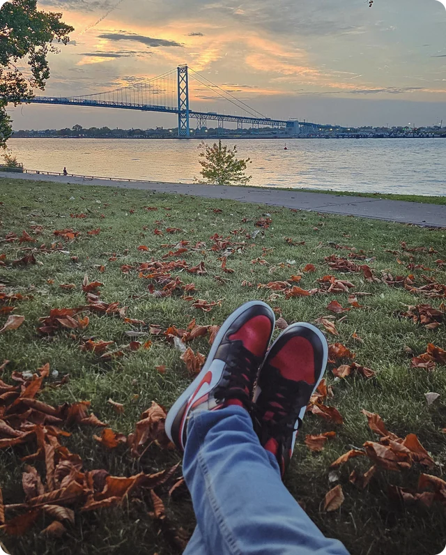

<a href="https://afrokk.studio">
  <picture>
    <source media="(prefers-reduced-motion: reduce) and (max-width: 600px)" srcset="assets/banner-narrow-still.webp">
    <source media="(prefers-reduced-motion: reduce)" srcset="assets/banner-still.webp">
    <source media="(max-width: 600px)" srcset="assets/banner-narrow.webp">
    
  </picture>
</a>

<samp>
<a href="https://afrokk.dev">afrokk.dev</a> ·
<a href="https://afrokk.studio">afrokk.studio</a> ·
<a href="https://www.linkedin.com/in/afrasiyab-k/">linkedin</a> ·
<a href="https://orcid.org/0009-0004-4176-0062">research</a> ·
<a href="mailto:hi@afrokk.dev">hi@afrokk.dev</a>
</samp>

 

I take something complicated and make it feel simple. At McGill, that's petabytes of radio telescope data and astrophysical research. At my software studio, it's a founder's rough idea. And on YouTube, it's the latest in tech, for an audience of over a million.

### Currently building

- **Software for a radio telescope.** [CHIME/FRB](https://www.chime-frb.ca) catches fast radio bursts from other galaxies. I build the systems that get them to astronomers, and the applications where anyone can browse them.
- **[afrokk.studio](https://afrokk.studio)**, where we build products end to end with a few founders at a time. Say hello: [hi@afrokk.dev](mailto:hi@afrokk.dev).
- **[Echo Thérapie](https://github.com/Echo-Therapie)**, with the studio: AI session management for therapists in Québec.
- **[Seed Jamaica](https://seedja.com)**, with the studio: people-first microloans for everyday Jamaicans.

 

Pronounced af-rock. Every object in the banner is something I use, except the CHIME model. That one’s a wish. Thanks for stopping by. 

 
